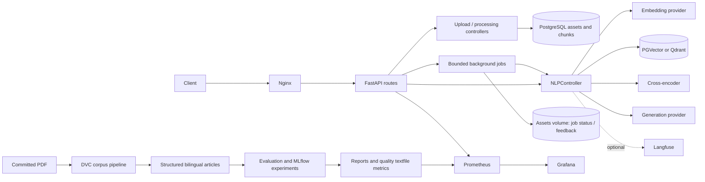

# RAG-ISHMS

FastAPI retrieval and question answering for ISHMS, with PostgreSQL assets/chunks,
PGVector or Qdrant retrieval, a cross-encoder reranker, and interchangeable generation
providers. The existing controller/provider architecture is retained.

The current work implements the MLOps plan for the final project. Generation model
setup and measured inference/quality results are intentionally deferred.

## Docker setup

With Python 3.12, uv and Docker installed, use these three commands:

```bash
uv sync --locked --group dev --group eval --group data
uv run python scripts/configure_api_access.py
docker compose -f docker/docker-compose.yml up -d --build
```

Before the third command, review `docker/env/.env.fastapi`, database/exporter and
Grafana settings. The setup script copies missing examples and creates a service
API key; it preserves existing database and model settings. A working generation
and embedding endpoint is a prerequisite for a healthy Q&A service. This task does
not supply, start, or download a generation model. To run infrastructure alone,
start `pgvector prometheus grafana node_exporter postgres_exporter` with Compose.

The newly generated client key is stored in ignored `docker/env/.env.client`.
Set `RAG_API_KEY` from that file in your client environment and send `X-API-Key`.
Keys map to `user_id` and explicit project IDs in `API_CLIENTS`; `["*"]` gives a
trusted service access to all projects. Authentication was enabled in the local
Docker API settings. Example files default to private development mode until the
setup script enables it. Secrets are not committed.

Keep one API worker. Model objects, job state and quotas belong to that process.
Health: `http://localhost:8000/health`; docs: `/docs`; Grafana: port 3000;
Prometheus: port 9090. `/metrics` is available on the backend and blocked at nginx.
Restrict direct development/monitoring ports to your trusted network.

## Architecture



## API and ingestion

Existing endpoints remain available:

- `POST /api/v1/data/upload/{project_id}`: multipart PDF/text upload.
- `POST /api/v1/data/process/jobs/{project_id}`: background processing, optional
  `{"W_qalam":true}` for bilingual article chunks.
- `POST /api/v1/nlp/index/jobs/{project_id}`: background embedding/indexing,
  `{"do_reset":0}` for upserts.
- `GET /api/v1/data/process/status/{job_id}` and
  `GET /api/v1/nlp/index/status/{job_id}`: authorized job status and result counts.
- `POST /api/v1/nlp/index/search/{project_id}` and `/index/answer/{project_id}`:
  `{"text":"question", "limit":5}`. Blank/oversized input or limit outside 1–20
  returns 422. No hits return a localized no-information answer and empty sources.
- `POST /api/v1/nlp/index/answer/stream/{project_id}`: real SSE sources/token/done
  events; provider failures produce error events. OpenAI-compatible generation only.
- `POST /api/v1/nlp/answer/feedback/{project_id}`: `request_id`, score −1 to 1,
  optional comment. Only receipts owned by that identity/project are accepted.

Synchronous process/push endpoints remain for compatibility. Same-project mutations
are rejected with 409 while processing/indexing is active. Jobs use bounded queues
and atomic snapshots; restart marks unfinished jobs failed rather than silently
resuming destructive resets. Retry an upsert after inspection. Partial writes may
remain after failure.

Answers include asset/page sources and, for article chunks, `article_number`,
`citation` and `source_pages`. Legacy chunks require reprocessing to obtain them.
Sources describe retrieved context, not a claim-by-claim correctness guarantee.
Collection names fingerprint embedding provider/model/dimension. Changing only the
generation model needs no reindex; changing embeddings does.

Reprocess/index a new demo document using `scripts/reindex_project.py`; it submits
and polls the existing API without changing the architecture.

## Reproducible corpus and evaluation

`uv run --group data dvc repro` rebuilds the source snapshot and structured corpus
in `data/corpus/`; `dvc status` verifies its hashes. The original PDF remains
committed, so a fresh checkout can rebuild without a configured DVC remote.
`dvc push/pull` needs a storage remote if you prefer distributing cached outputs.
The 1,149-record corpus flags repeals and preserves page/hierarchy metadata.
Its pinned source issue manifest records missing Arabic text for Article 1022;
that record needs review. Arabic extraction still needs human spot-checking.

The original 20-case CI set is preserved. `eval/monitoring_set.json` adds 50
answerable bilingual/paraphrase cases and two out-of-corpus cases. They are drafts,
not human-approved labels. Review them before treating scores as release evidence.

The evaluator supports faithfulness, response relevancy, context precision and
context recall, with a deterministic judge and separate Arabic/English gates.
`scripts/run_experiments.py` runs five chunking/retrieval configurations in disposable
indexes and logs parameters, metrics and reports to MLflow. It never resets the
application index. These commands require configured inference/judge endpoints;
no measured scores or MLflow runs have been fabricated. See [evaluation](eval/README.md).

## Monitoring, guardrails and verification

Prometheus/Grafana are provisioned from the repository. Metrics cover HTTP requests,
full response latency, RAG stages/outcomes, reranker scores, actual non-stream token
usage, inflight generation, stream TTFT/duration and guardrail decisions. IDs and
project values are not metric labels. Quality panels consume real reports via
`scripts/publish_eval_metrics.py`; no report means no quality data.

API-key authorization, project checks and single-worker token buckets return
401/403/429, with `Retry-After` on throttling. Guardrails detect limited explicit
English/Arabic instruction overrides and redact bounded email, Egyptian phone,
national-ID and labeled patient-name patterns. Buffered stream redaction protects
matches split across tokens but adds output delay. These rules do not establish
medical privacy or catch all prompt injections. Do not use patient data without
reviewing the ISHMS identity/privacy requirements.

Langfuse is opt-in, with content omitted from traces by default; identifiers,
configuration, stage timing and actual usage are recorded. Local feedback is
redacted and stored even if export fails. See [observability setup](docs/observability.md).

`uv run --group dev pytest` enforces 70% source coverage without weights or paid
calls. `uv run --group dev pre-commit run --all-files` checks formatting/lint.
Real model quality, load reports and external CI results remain unmeasured.
The nightly evaluation is opt-in via `RAG_NIGHTLY_EVAL_ENABLED=true` in GitHub;
scheduled runs do not publish Docker images.

Session changelog: earlier work supplied packaging/contracts/citations/CI/Docker;
session 3 adds background processing/indexing, threaded work and streaming;
session 4 adds access controls, guardrails, tracing/feedback, provisioned quality
monitoring and evaluation tools. [Full plan status](docs/plan-review.md),
[runbook](docs/runbook.md), and [separate vLLM setup](docs/model-serving.md) describe
remaining scope. `certifcates_sys/` is a separate assignment.
