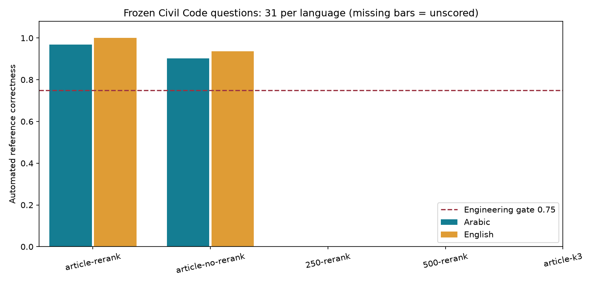
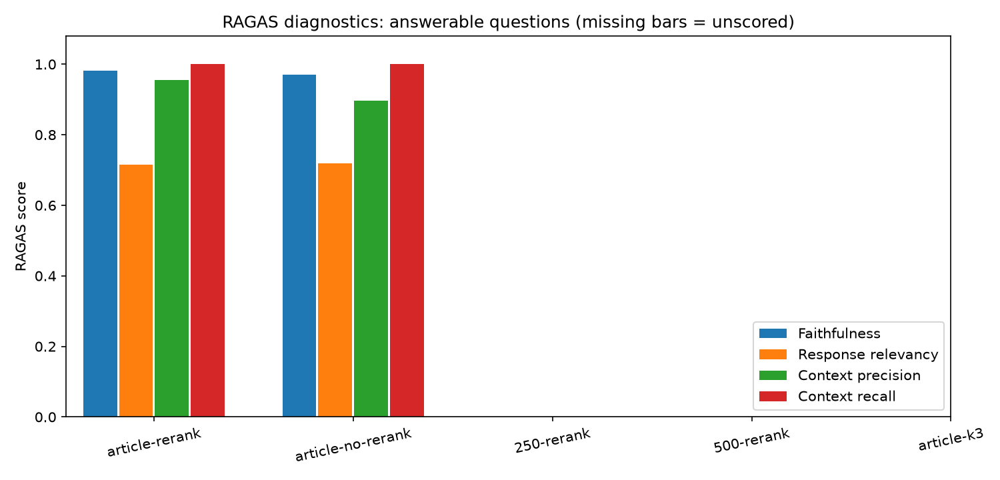
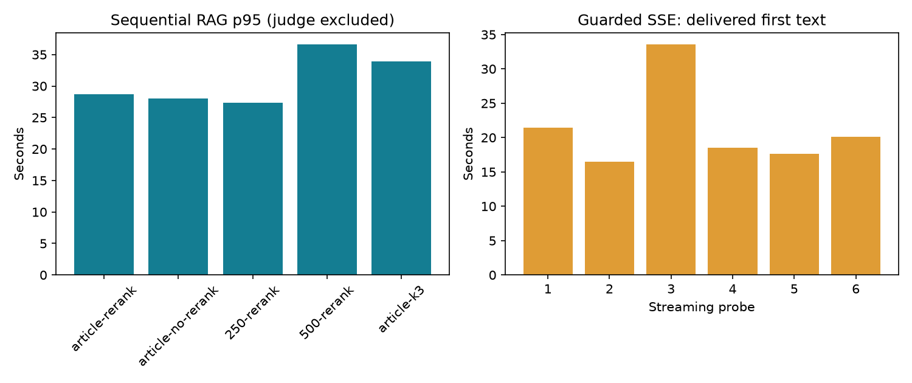
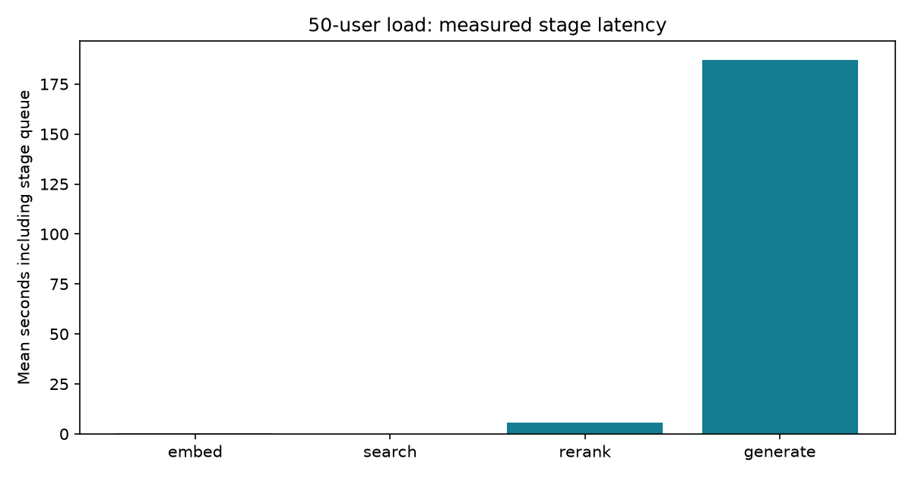

# Final-project evaluation report

Measured Civil Code retrieval, answer quality and local serving capacity. These results are engineering diagnostics; they do not certify legal correctness.

**Scoring is incomplete.** All five configurations have captured 62 answers each. Missing scores are n/a; no five-way quality winner or promotion is claimed while the consistent regrade is unfinished.

## Source and experiment

- Supplied PDF: `G:\Downloads\1576751803.pdf`, 170 pages.
- SHA-256: `2d6419fb262dab712f7bf5f6e31834bea74fbcf03b78ae081dd35d156915eebf`.
- Qalam: 1,149 articles and 2,297 nonempty language chunks; known Article 1021/1022 alignment defect retained and excluded from references.
- Frozen questions: 62, with 25 answerable and six unanswerable in each language, covering 25 distinct articles. Assistant source review; no independent legal expert review.
- All five configurations use full-corpus retrieval, local Qwen3-4B-Instruct-2507 at the pinned revision, temperature zero, maximum 256 output tokens, and the existing BGE GPU reranker where enabled.
- Quality runs seed disposable embedded Qdrant indexes from the extracted Qalam articles and use the existing RAG controller. The separate real upload/process/index load workflow uses PGVector; no backend-quality equivalence is inferred.
- Generator uses 4-bit NF4 on the 6-GiB RTX 3060; context 2,048, one active generation sequence. No adapter is loaded and no training was performed.
- Direct NVIDIA Nemotron VL 1B v2 embeddings (2,048 dimensions) avoid exhausting the production OpenRouter 50-request daily allowance. Existing production settings/indexes were preserved.
- Independent judge: NVIDIA Nemotron 3.5 Super VL 120B, temperature zero, candidate-unicode-v2 rubric. All 28 bilingual numerical, completeness and refusal controls passed before scoring. All five configurations use this same judge/profile in a separate scoring directory; legacy scores are not mixed in. Controls are a sanity check, not legal expert validation.
- HTTP 429 interrupted the first scoring attempt. Saved answers and completed scores were resumed with request pacing; no answers were regenerated to improve scores.
- An unterminated judge JSON response also interrupted scoring. Invalid/truncated output is rejected; rubric calls use 2,048 output tokens, with one 4,096-token retry only when the API reports length termination. Partial responses never become scores. Successful rubric/RAGAS calls are cached against exact inputs for resume.
- The offline scorer was deliberately checkpointed to load scheduling/recovery fixes. KeyboardInterrupt entries in scoring-unicode-v2.log document those worker restarts; they are not repeated model training or RAG generation. Intermittent provider 500s retain cached work and reset the recovery budget only after completed-case progress; four consecutive failures without progress remain bounded.

## Earlier training and model selection

The earlier remote pilot trained M/A and ordinary-SFT adapters for 117 updates each on the same 466 examples (233 per language), with 32 held-out examples. Both used two T4s through single-process model parallelism. A separate DDP diagnostic does not make those training runs DDP. Local artifact checks reproduced the recorded string metrics and verified finite changed adapters; GPU training was not rerun locally.

The subsequent frozen 52-case acceptance study compared base/SFT/M-A with 156 saved generations. Cue's strict semantic judgments, whose counts were recomputed locally but not independently legally regraded, were:

| Candidate | English / 26 | Arabic / 26 | Overall / 52 |
|---|---:|---:|---:|
| Untuned base | 21 | 13 | 34 |
| SFT v2 | 18 | 0 | 18 |
| M/A v2 | 12 | 4 | 16 |

Those acceptance contexts were English for both question languages, so Arabic results include cross-language answering. They cannot be compared directly with the current 62-case bilingual retrieved-context benchmark or the pilot's token F1. Base had the best balance of supported answers and refusals among these candidates, but still failed cases. Neither adapter was promoted; the selected base is served locally without an adapter.

The pilot's M/A adapter showed more masked-evidence rejection with reduced answer utility. Five English training examples had evidence/mask-label conflicts; the origin of an old baseline file remains unresolved and it was excluded from improvement claims. The later shared-input comparison was separately audited. This work does not establish general hallucination reduction or certification. Historical audit/review files are included under prior-model-study/ in the evidence archive, clearly separate from current local serving checks. Cue reports Kaggle stopped and retained its saved artifacts; no new remote experiment was launched here.

## Application fixes and validation

The real upload/process workflow exposed a numeric asset-ID lookup bug; processing now accepts the ID returned by upload while retaining filename lookup and project scope. Queued model calls now wait asynchronously before entering a worker, so the model lock does not consume the worker pool. Bulk SQL operations have a 30-second budget; readiness retains its separate deadline. PGVector reindex batches replace only their supplied chunk IDs transactionally, with configurable batch size (default 50).

Verification: 242 tests passed with 86.55% source coverage. Two actual same-vector reinsertions into the isolated PGVector project left exactly 2,297 rows. The existing Docker API was rebuilt after confirming no active production jobs; nginx health returned 200, missing-key requests 401 and authenticated blank queries 422, all with request IDs. These health/authentication checks also passed after the subsequent laptop restart on 16 October. Existing credentials, documents and production indexes were preserved.

## Five configuration comparisons

| Configuration | Faithfulness | Relevancy | Context precision | Context recall | Reference accuracy | p95 seconds | Scored / 62 | Gate |
|---|---:|---:|---:|---:|---:|---:|---:|---|
| article-rerank | 0.981 | 0.715 | 0.955 | 1.000 | 0.984 | 28.719 | 62/62 | PASS |
| article-no-rerank | 0.971 | 0.719 | 0.896 | 1.000 | 0.919 | 28.000 | 62/62 | PASS |
| 250-rerank | n/a | n/a | n/a | n/a | n/a | 27.308 | 8/62 | PENDING |
| 500-rerank | n/a | n/a | n/a | n/a | n/a | 36.618 | 0/62 | PENDING |
| article-k3 | n/a | n/a | n/a | n/a | n/a | 33.956 | 0/62 | PENDING |

| Configuration / language | Answerable accuracy | Abstention accuracy | Article hit rate |
|---|---:|---:|---:|
| article-rerank / ar | 1.000 | 0.833 | 1.000 |
| article-rerank / en | 1.000 | 1.000 | 1.000 |
| article-no-rerank / ar | 0.920 | 0.833 | 1.000 |
| article-no-rerank / en | 0.960 | 0.833 | 1.000 |
| 250-rerank / ar | n/a | n/a | 1.000 |
| 250-rerank / en | n/a | n/a | 1.000 |
| 500-rerank / ar | n/a | n/a | 1.000 |
| 500-rerank / en | n/a | n/a | 1.000 |
| article-k3 / ar | n/a | n/a | 1.000 |
| article-k3 / en | n/a | n/a | 1.000 |

Faithfulness excludes expected refusals; reference accuracy includes them. Additional RAGAS scores cover answerable questions only. PASS is the automated engineering threshold, not legal acceptance: the judge's known false positives below can overestimate correctness. Generation remains sequential; remote grading is excluded from response latency. Completed per-case answers and exact retrieved contexts are saved. MLflow records the five configurations and artifacts; interrupted attempts remain visible.

Runs were collected sequentially across a host restart with variable GPU clocks and provider availability. Latency differences are observations from these runs, not a controlled speedup estimate. Missing judge scores are withheld rather than averaging incomplete case subsets.

## Load and streaming

Locust used 50 independent identities (observed peak 50), spawn rate 5/s, 180 seconds plus up to 180 seconds to drain. Exit code: 1. The isolated API uses the existing application code on localhost:8003, PGVector, the full Qalam-upload/process/index workflow, local GPU servers and direct NVIDIA embeddings. This measures the application directly; it is not a production nginx/OpenRouter capacity claim.

The original Qdrant load run exposed worker-pool starvation: 66 answer requests, 49 failures, and all four health checks failed. An async wait gate now keeps queued model calls outside the worker pool. The later PGVector run also changes the backend and fixes the workload seed, so differences cannot be attributed solely to that fix. A preceding PGVector setup indexed all 2,297 chunks but stopped during SSE after a CUDA unknown-error crash; it is preserved separately. The measured PGVector retry reused that verified index after the host restart.

Answer requests: 58; failed: 50; median: 180000 ms; p95: 180000 ms; p99: 180000 ms. Inspect the failure CSV and provider logs alongside aggregate rates; HTTP 200 with empty answers/sources is also a load-test failure.

Nonempty-answer goodput: 0.022 requests/s over 356.7 seconds including drain. This counts responses passing the workload's answer/source check, not legally correct answers. The configuration does not meet the 50-user capacity target.

| Stage | Samples | Mean seconds | p95 histogram upper bound seconds |
|---|---:|---:|---:|
| embed | 58 | 0.530 | 1.000 |
| search | 58 | 0.035 | 0.100 |
| rerank | 58 | 5.590 | 20.000 |
| generate | 20 | 187.179 | 600.000 |

Stage timings include serialization/queue waits. Histogram p95 values are bucket bounds, not precise per-request quantiles; separate stage p95s cannot identify which stage occurred in the same p95 request.

Six bilingual SSE probes: first delivered text p50 18.553s, p95 33.569s. Mean end-to-end output rate 2.624 tokens/s, counted with the served Qwen tokenizer. Guardrails buffer text until filtering completes, so delivered first text is not engine-internal TTFT or an unbuffered streaming claim.

## Answer inspection

The assistant compared all 62 article-rerank outputs with their frozen references; this is not independent legal expert labeling. Arabic Article 94 omits the meeting-end acceptance condition, Article 147 omits the contrary-agreement void clause, and the person-name negative returns a generic legal category. Article 226 reaches the 256-token cap and ends midword while omitting reference conditions. These are practical failures to retain even if an automated gate passes.

The legacy Super judge misread a clear Arabic court-address refusal and invented claims when grading the Article 374 answer. Its original machine scores are preserved under configurations/ for audit. The evidence includes assistant-answer-review.json with exact case IDs; no assistant-corrected legal accuracy percentage is inferred.

The revised judge also misses real defects: for Arabic Article 44 it assigns full faithfulness while omitting the unsupported definition of legal interdiction from its claim list. It accepts the incomplete Arabic Article 94, 147 and truncated Article 226 answers despite the earlier source review's findings. The shorter omission control passed, but that did not transfer reliably to these longer real outputs. Passing calibration does not guarantee exhaustive claim extraction or legally correct grading; every reported correctness score remains an automated estimate. See revised-judge-review.json; original scores are preserved.

A recovery check on 16 October found Nemotron 3.5 Super VL callable, but the legacy rubric failed 11 of 28 controls. Investigation found that Arabic rubric inputs were Unicode-escaped and candidate claims could be confused with reference claims. The revised rubric sends readable Arabic, explicitly identifies candidate_answer, forbids replacing its words/numbers with reference claims and rejects omitted required conditions. It passed all 28 controls; super35-judge-calibration.json records the revised results and super35-legacy-rubric-calibration.json retains the failures. Changing serialization, instructions and judge requires regrading every configuration separately; earlier scores are not comparable as a model-quality improvement. DeepSeek V4.1 Flash timed out with its documented non-thinking option.

Provider availability was checked on 2026-10-15. NVIDIA's official catalogue marks the free endpoints for [Qwen3.5-397B](https://build.nvidia.com/qwen/qwen3.5-397b-a17b?api=true) and [GPT-OSS-120B](https://build.nvidia.com/openai/gpt-oss-120b) as deprecated; a model listing is not evidence that the existing account can call it. Existing-account probes and failed calibration results remain in the evidence; no paid endpoint or new account was introduced.

Targeted comparison reviews cover 11 Arabic no-rerank cases and seven 250-character cases. Several baseline omissions persist. The 250-character configuration answers age 20 for Article 44 even though its retrieved Arabic and English passages both state twenty-one; this is a numerical generation error with the correct evidence present. Its English Article 1 answer also introduces incorrect article attributions and an extra fallback. These examples prevent an error-free-accuracy claim independently of the judge's availability.

Seven-case reviews of the 500-character and top-three article variants are also saved. Top-three retrieval includes the missing Article 147 void-agreement clause and the required Article 226 conditions, but its Article 44 response contradicts itself: twenty-one in the opening, then 18 twice. The person-name refusal failure persists. These targeted improvements and regressions do not establish an overall winner; the existing production retrieval configuration is retained.

## Scope and remaining human decisions

No new fine-tuning, remote deployment, index replacement, Canary/BentoML/Redis stack, or Cue/Kaggle work was performed. Existing runtime architecture remains intact. Model choice from the earlier acceptance study remains the untuned Qwen base; this comparison varies retrieval configuration, not trained adapters.

Legal expert review and a larger independently labeled held-out benchmark remain human work. Automated judge errors must be resolved before treating these scores as legal accuracy. External Langfuse credentials, alert destinations, registry promotion and protected CI secrets are optional external setup, not completed experiments. Do not promise that a small benchmark eliminates model failure.

The SSE tokenizer counts support the reported end-to-end output rate. No provider price table or hardware energy accounting was configured, so no dollar-cost-per-answer estimate is fabricated.

## Evidence and reproduction

See `eval/CIVIL_CODE_EVALUATION.md` for the frozen dataset, extraction and five-run command. Raw reports, checkpoints, calibration, exact contexts, MLflow tracking database, Locust CSV/HTML, streaming probes and metric snapshots remain local under `eval/reports/final-project/` and `reports/mlflow.db`. No secrets are included in the shareable evidence archive.

The Grafana screenshot shows the configured production dashboard and the published completed article-rerank scores from the current versioned judge. The isolated port-8003 load API was not a Prometheus scrape target; its stage figures use the saved before/after metric snapshots. Locust HTML is a periodic snapshot; final JSON counts after draining take precedence.

## Figures

